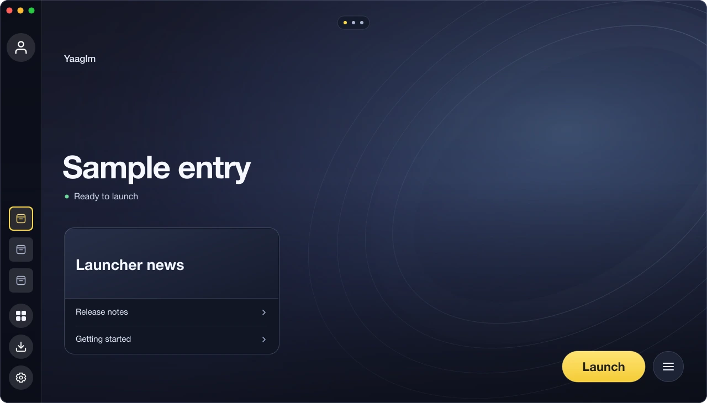

# Yaaglm — Yet Another Anime Game Launcher Modified

[简体中文](docs/README.zh-CN.md)

> **Personal fork notice**
>
> Yaaglm is an independently maintained fork of [Yaagl](https://github.com/yaagl/yet-another-anime-game-launcher). It combines launcher functionality synchronized from upstream with Yaaglm-specific changes. Its releases, supported clients, and support may differ from the upstream project; it is not an official upstream build.

## Launcher preview

## Supported games and channels

Release packages cover these clients and regions:

- GI: CN and Global
- HSR: CN and Global
- ZZZ: CN and Global
- BH3: Global
- CBJQ: CN and Global

Some releases also provide combined launcher packages for multiple clients. Package availability, game-version compatibility, and macOS requirements can change; check the [latest release](https://github.com/MXJinjing/yet-another-anime-game-launcher/releases/latest) and its notes before installing or updating.

## Features

### Launcher features

- Install, update, repair, pre-download, and check the integrity of supported game files.
- On supported clients, choose a full or base installation and select optional voice packs.
- Use Sophon for supported clients and Aria2 for other clients, with download tasks and detailed progress in the launcher.
- Manage Wine distributions and per-game settings for graphics, controls, and launch behavior.
- Configure compatible graphics options such as DXMT, D3DMetal, and MetalFX where supported by the selected game and Wine runtime.
- Use a localized interface, automatic launcher updates, and in-app release notes.

### Yaaglm additions

- Combined launcher packages bring multiple CN or Global clients into a single game library.
- A separate live log window can follow launcher and game logs in tabs, open selected log files, and copy log output.
- The game library can show per-game artwork and video backgrounds.
- Hosts Helper can manage the launcher's hosts rules with macOS authorization.

Features vary by game, region, and Wine runtime. Options that are unavailable or incompatible with a selected client may be hidden or disabled.

## For Linux users

Yaaglm targets macOS. For Linux, see [Anime Games Launcher](https://github.com/an-anime-team/anime-games-launcher).

## Is it safe?

Use Yaaglm at your own risk. It runs Windows software through Wine and downloads game files and runtime components from their configured sources. Compatibility and account safety are not guaranteed. Test with a separate installation and keep backups of important files and settings.

## Support

For general usage questions, see the [Yaagl community Discord](https://discord.gg/HrV52MgSC2). This is an independent fork, so identify the Yaaglm release and channel when asking for help; upstream volunteers may not support fork-specific changes.

Open a [GitHub issue](https://github.com/MXJinjing/yet-another-anime-game-launcher/issues) only for a reproducible technical problem. Include the Yaaglm version, channel, macOS version, steps to reproduce, and relevant logs or system information. Remove account details, tokens, and other private information before sharing logs.

## Install

1. Download the release for the game channel and Mac architecture you need from [Releases](https://github.com/MXJinjing/yet-another-anime-game-launcher/releases/latest).
2. Open the DMG and move the app to <code>/Applications</code>. Launch it from there, not from Downloads.
3. Keep game files in a writable folder under your home directory, such as <code>~/Games</code>, rather than inside <code>/Applications</code>.
4. Follow the first-run prompts to install or select a Wine environment and set up the game files.

## Development

To run the desktop app from source on macOS:

~~~sh
pnpm install
./configure.sh
./build-sophon.sh
pnpm start
~~~

<code>pnpm dev</code> starts the Vite frontend only. <code>pnpm start</code> builds and runs the default desktop channel; use a channel-specific <code>start-*</code> script from <code>package.json</code> to run another supported channel. <code>YAAGL_CHANNEL_CLIENT</code> selects the channel for direct builds.

### Build release packages

Set the release version, prepare the Sophon sidecar for the target architecture, then run the command for each architecture you want to package:

~~~sh
export YAAGL_VERSION="$(node -p 'require("./package.json").version')"
YAAGL_BUILD_ARCH=arm64 bash scripts/build-release.sh
YAAGL_BUILD_ARCH=x64 bash scripts/build-release.sh
YAAGL_BUILD_ARCH=universal bash scripts/build-release.sh
~~~

A universal build needs Sophon sidecars for both arm64 and x64. The script produces DMG installers and app archives for the release channels.

## Uninstall (completely)

1. If Hosts Helper is installed, uninstall it from **Global Settings → General → Hosts Helper**.
2. In **Global Settings → General → Launcher Data**, choose **Clear Launcher Data**. This moves Yaaglm's settings, caches, logs, and locally managed Wine data to the Trash, then quits the app. Review the confirmation before continuing.
3. Move Yaaglm to the Trash.

To locate the current channel's data folder manually, open **Launcher Data → Open in Finder** in Yaaglm, or use Finder's **Go → Go to Folder…** and enter <code>~/Library/Application Support/</code>. Quit Yaaglm before moving the folder to the Trash. This launcher data folder is separate from your game installation folder.

## Related projects

- [Custom Neutralino runtime](https://github.com/3Shain/neutralinojs)
- [DXMT](https://github.com/3Shain/dxmt)
- [Wine runtime project](https://github.com/yaagl/anime-game-wine)
- [Anime Games Launcher for Linux](https://github.com/an-anime-team/anime-games-launcher)

## Special thanks

- An Anime Team
- Krock, whose work helped make running games on macOS possible
- mkrsym1, for work on a particularly challenging compatibility component
- rishabhroyy, whose fork provided a reference for the multi-channel launcher UI and logic

## License

See [LICENSE](LICENSE) and the notices included with bundled third-party components. Each component remains subject to its own license and terms.
