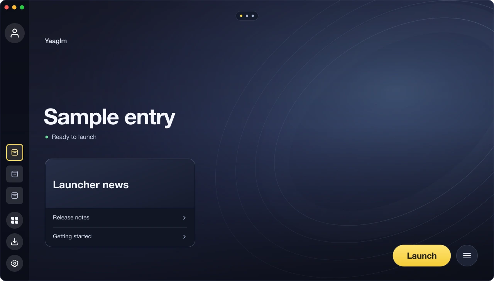

# Yaaglm — Yet Another Anime Game Launcher Modified

[English version](../README.md)

> **个人 Fork 说明**
>
> Yaaglm 是基于 [Yaagl](https://github.com/yaagl/yet-another-anime-game-launcher) 独立维护的 fork，包含与上游同步的启动器功能以及 Yaaglm 自有改动。它的发行包、支持的客户端和支持渠道可能与上游不同，不是上游官方构建版本。

## 启动页示意

## 支持的游戏与渠道

发行包覆盖以下客户端和区域：

- GI：中国服和国际服
- HSR：中国服和国际服
- ZZZ：中国服和国际服
- BH3：国际服
- CBJQ：中国服和国际服

部分发行版还提供整合多个客户端的启动器。发行包可用性、游戏版本兼容性和 macOS 要求可能随版本变化；安装或更新前请查看[最新发行版](https://github.com/MXJinjing/yet-another-anime-game-launcher/releases/latest)及其说明。

## 功能

### 启动器功能

- 安装、更新、修复、预下载游戏文件，并检查文件完整性。
- 对支持的客户端，可选择完整或基础安装模式及可选语音包。
- 支持的客户端使用 Sophon，其他客户端使用 Aria2；下载任务和详细进度都可在启动器中查看。
- 管理 Wine 发行版，以及每个游戏的图形、控制器和启动行为设置。
- 根据所选游戏和 Wine 运行时，配置受支持的 DXMT、D3DMetal、MetalFX 等图形选项。
- 提供多语言界面、启动器自动更新和应用内版本说明。

### Yaaglm 自有功能

- 整合启动器可将多个国服或国际服客户端放进同一个游戏库。
- 独立的实时日志窗口可按标签页查看启动器和游戏日志、打开指定日志文件并复制日志内容。
- 游戏库可显示每个游戏的美术图，也支持视频背景。
- Hosts Helper 可在 macOS 授权后管理启动器使用的 hosts 规则。

具体功能会因游戏、区域和 Wine 运行时而异。当前客户端不支持或不兼容的选项可能会隐藏或禁用。

## Linux 用户

Yaaglm 面向 macOS。Linux 用户可查看 [Anime Games Launcher](https://github.com/an-anime-team/anime-games-launcher)。

## 安全性

请自行评估并承担使用风险。Yaaglm 通过 Wine 运行 Windows 软件，并从对应来源下载游戏文件和运行时组件；项目无法保证兼容性或账号安全。建议先使用独立的游戏安装目录进行测试，并备份重要文件和设置。

## 支持

一般使用问题请查看 [Yaagl 社区 Discord](https://discord.gg/HrV52MgSC2)。这是一个独立 fork，提问时请说明 Yaaglm 版本和渠道；上游志愿者可能无法处理 fork 专有改动。

只有可复现的技术问题才适合提交 [GitHub Issue](https://github.com/MXJinjing/yet-another-anime-game-launcher/issues)。请提供 Yaaglm 版本、渠道、macOS 版本、复现步骤以及相关日志或系统信息。分享日志前，请移除账号信息、令牌和其他隐私内容。

## 安装

1. 前往 [Releases](https://github.com/MXJinjing/yet-another-anime-game-launcher/releases/latest)，下载适合目标游戏渠道和 Mac 架构的发行包。
2. 打开 DMG，将应用移到 <code>/Applications</code>，并从该目录启动；不要直接从 Downloads 运行。
3. 将游戏文件放在用户目录下可写入的位置，例如 <code>~/Games</code>，不要放入 <code>/Applications</code>。
4. 首次启动时按提示安装或选择 Wine 环境并准备游戏文件。

## 开发

在 macOS 上从源码运行桌面应用：

~~~sh
pnpm install
./configure.sh
./build-sophon.sh
pnpm start
~~~

<code>pnpm dev</code> 只启动 Vite 前端。<code>pnpm start</code> 会构建并运行默认桌面渠道；要运行其他渠道，请使用 <code>package.json</code> 中对应的 <code>start-*</code> 脚本。直接构建时可通过 <code>YAAGL_CHANNEL_CLIENT</code> 选择渠道。

### 构建发行包

设置发行版本，先准备对应架构的 Sophon sidecar，再执行所需架构的命令：

~~~sh
export YAAGL_VERSION="$(node -p 'require("./package.json").version')"
YAAGL_BUILD_ARCH=arm64 bash scripts/build-release.sh
YAAGL_BUILD_ARCH=x64 bash scripts/build-release.sh
YAAGL_BUILD_ARCH=universal bash scripts/build-release.sh
~~~

通用包需要 arm64 和 x64 两种 Sophon sidecar。脚本会为各发行渠道生成 DMG 安装镜像和应用归档文件。

## 完全卸载

1. 如果安装了 Hosts Helper，请在 **全局设置 → 通用 → Hosts Helper** 中卸载。
2. 在 **全局设置 → 通用 → 启动器数据** 中选择 **清理启动器数据**。Yaaglm 会把设置、缓存、日志和本地管理的 Wine 数据移到废纸篓，然后退出。操作前请先查看确认信息。
3. 将 Yaaglm 移到废纸篓。

如需手动查找当前渠道的数据目录，可在 Yaaglm 的 **启动器数据 → 在 Finder 中打开** 中打开，或在访达选择 **前往 → 前往文件夹…** 并输入 <code>~/Library/Application Support/</code>。将该目录移到废纸篓前，请先退出 Yaaglm。启动器数据目录与游戏安装目录分开。

## 相关项目

- [Custom Neutralino runtime](https://github.com/3Shain/neutralinojs)
- [DXMT](https://github.com/3Shain/dxmt)
- [Wine 运行时项目](https://github.com/yaagl/anime-game-wine)
- [Linux 版 Anime Games Launcher](https://github.com/an-anime-team/anime-games-launcher)

## 致谢

- An Anime Team
- Krock：他的工作帮助实现了在 macOS 上运行游戏
- mkrsym1：感谢他攻克一个极具挑战性的兼容组件
- rishabhroyy：多渠道启动器 UI 和逻辑参考了他的 fork

## 许可证

请参阅仓库中的 [LICENSE](../LICENSE) 和随附第三方组件的许可声明。各组件分别受其自身许可证和条款约束。
